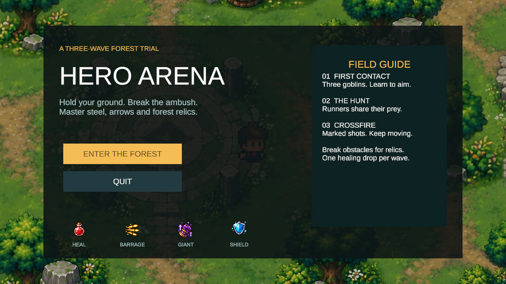
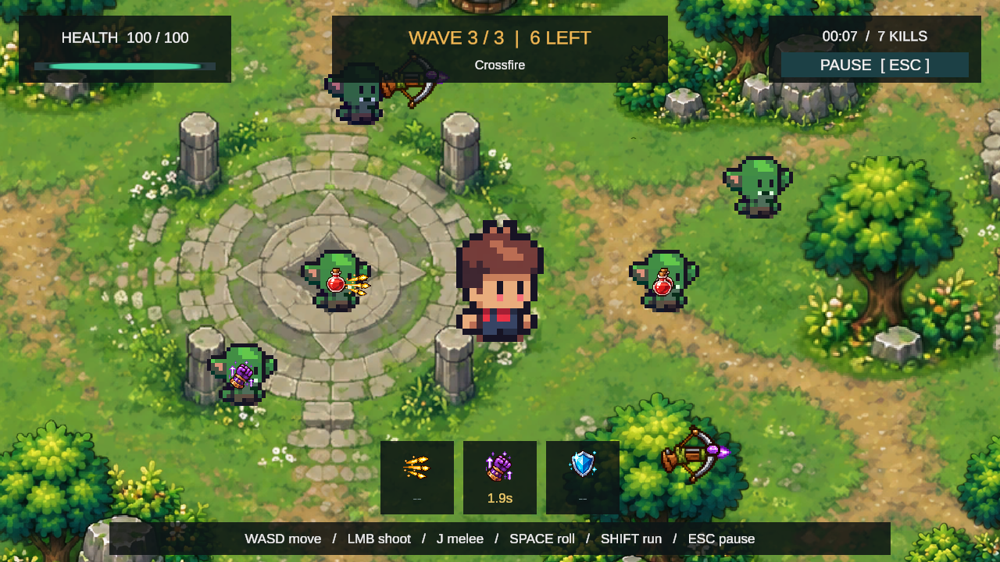

# HeroArena

> 🎮 基于 Unity 2022.3 + C# 开发的 2D 像素风动作 RPG Demo  
> 🚧 个人独立开发中，项目持续迭代

HeroArena 是一个基于 Unity 2022.3 + C# 独立开发的 2D 像素风 Action RPG 战斗 Demo。

项目已具备三波挑战的完整流程：主角近战与鼠标射击、普通/Runner/远程哥布林、可破坏环境与四种掉落增益，以及开始、暂停、胜利、失败和整局重开。

项目开发过程中注重功能模块复用、角色状态约束以及实际问题定位，并持续通过 Git 进行功能迭代与版本管理。

---

## 🎬 游戏演示

当前主菜单与第三波场景（第三波图来自自动验证）：





历史Gameplay录像：


▶️ **[查看完整游戏演示（Bilibili）](https://www.bilibili.com/video/BV1g8He6TEKb)**
---

## ✨ 已实现功能

### Player

- 移动 / 奔跑
- J 近战攻击 / 鼠标左键持续朝鼠标射击
- 翻滚
- 翻滚期间无敌
- 翻滚穿越敌人
- Hurt 受伤与受伤硬直
- Death 死亡
- 整局重新挑战，恢复角色与场景
- Attack / Roll / Hurt / Death 动作状态约束与中断处理


### Enemy

当前敌人：`Gobling`、`GoblinRunner`、`GoblinArcher`

- Runner 同波受伤警戒与锁定追击
- 弩手保持射程、贴近后退、0.4 秒瞄准预警、投射物攻击

- Idle / Chase / Attack / Hurt / Death 状态
- 基于 NavMeshPlus 的 2D 寻路与玩家追踪
- 静态地图边界与场景障碍规避
- 根据移动方向调整角色朝向与攻击方向
- 攻击距离判断与攻击冷却
- Animation Event 同步攻击判定
- 受伤、死亡与状态切换处理
- 死亡后禁用攻击、碰撞与伤害接收并延迟销毁

---

### Environment & Navigation

- 可破坏场景障碍物
- 复用 `IDamageable / DamageReceiver / Health` 通用伤害结构
- 使用 NavMeshPlus 构建 2D 可行走区域
- 分离物理碰撞区域与 AI 导航阻挡区域
- 障碍物销毁后动态重建 NavMesh
- 敌人能够根据场景变化重新规划移动路径
- 使用 Cinemachine 实现玩家相机跟随与地图边界限制


## ⚔️ Combat System

基础伤害结构：

```text
Attack
  ↓
IDamageable
  ↓
DamageReceiver
  ↓
Health
  ↓
OnDamaged / OnDied
  ↓
Player / Enemy / Destructible
```

通过 `IDamageable`、`DamageReceiver` 与 `Health` 分离攻击、伤害接收和生命值管理，并复用于 Player、Enemy 与 Destructible。

`Health` 通过事件通知受伤和死亡，使生命值逻辑不直接依赖具体角色或场景对象的行为。

---

## 🎬 Animation & State

角色动画使用 Unity Animator 管理，并通过 Animation Event 同步：

- 攻击伤害判定
- Attack 状态结束
- Hurt 硬直结束

针对 Attack / Roll 被 Hurt 等高优先级状态打断的情况，在代码层实现主动取消和状态清理，避免动画中断后产生状态残留。

Roll Coroutine 同样支持主动取消，确保中断后正确恢复碰撞、无敌和角色状态。

---

## 🔄 挑战与游戏流程

| 波次 | 阵容 | 总血量 |
|---|---|---|
| First Contact | 3 普通 | 150 |
| The Hunt | 2 普通 + 2 Runner | 200 |
| Crossfire | 2 普通 + 2 Runner + 2 弩手 | 280 |

波间休息 3 秒，每波至少一份回血掉落。敌人与障碍物可掉落回血、6 秒自动弹幕、8 秒巨化、5 秒护罩；同类增益刷新时间，暂停冻结，死亡清除。

从开始菜单进入挑战，Esc 暂停。全部击败进入胜利界面；玩家死亡进入失败界面。重新挑战与返回菜单均重新载入场景，恢复玩家、障碍物和生成物。`GameManager` 的自动重生接口仍保留，正式挑战通过 `PlayerHealth.autoRespawn=false` 关闭。

操作：WASD / 方向键移动，Shift 奔跑，空格翻滚，鼠标左键射击，J 近战，Esc 暂停。

---

## 🛠️ 技术栈

- Unity 2022.3 LTS
- C#
- Unity Input System / uGUI / TextMeshPro
- Animator / Animation Event
- Rigidbody2D / Physics2D
- NavMeshPlus / Unity AI Navigation
- Cinemachine
- Coroutine
- Git / GitHub

---

## 📁 项目结构

```text
Assets/
├── Scripts/
│   ├── Player/
│   ├── Enemy/
│   ├── Combat/
│   └── Managers/
├── Prefabs/
│   ├── Player/
│   └── Enemy/
└── ...

Documentation/
└── DevLog/
```


---

## 🗺️ 开发进度

- [x] 玩家移动与角色控制
- [x] 基础战斗与伤害系统
- [x] Roll 闪避 / 无敌 / 敌人穿越
- [x] Hurt / Death / Respawn
- [x] Enemy 状态 AI
- [x] Enemy Attack / Hurt / Death
- [x] 2D NavMesh 寻路与障碍规避
- [x] 可破坏场景障碍
- [x] 障碍销毁后的动态导航更新
- [x] Cinemachine 相机跟随与地图边界限制
- [x] Gameplay UI / Health UI / 开始暂停与胜负流程
- [x] 玩家射击、远程哥布林与三波挑战
- [x] 回血、弹幕、巨化和护罩掉落
- [ ] 战斗反馈与视觉表现优化
- [ ] 更多 Gameplay 内容

---

## 📌 项目状态

HeroArena 目前已完成基础战斗 Gameplay 闭环，并持续进行功能迭代与表现优化。

当前版本已接通三波战斗、掉落与增益、完整 UI 和重新开局。Unity Play Mode 自动验证覆盖射击、敌人、增益和流程；首版难度数值仍需人工实玩校准。

项目主要用于 Unity 游戏客户端开发方向的学习与实践，后续重点为人工难度调优、音效与战斗反馈，以及作品展示素材更新。上方演示视频为历史版本。